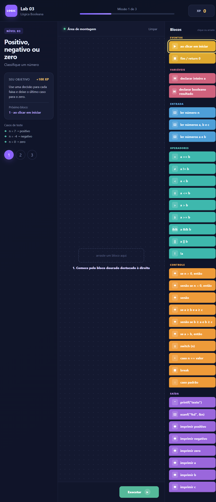

# Game para Aprender Código

Jogo educativo desenvolvido em React e Vite para praticar lógica booleana e estruturas condicionais em C.

## Acesse o jogo

[Jogar online](https://gameaprendercodigo.vercel.app/)



## Recursos

- Blocos de eventos, variáveis, entrada, operadores, controle e saída
- Missões sobre classificação de números e comparação de valores
- Área de montagem com sequência e validação dos blocos
- Terminal visual com exemplos de execução
- Revelação do código C correspondente a cada missão
- Sistema de progresso e XP

## Executar localmente

```bash
npm install
npm run dev
```

## Build de produção

```bash
npm run build
```
